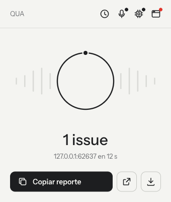
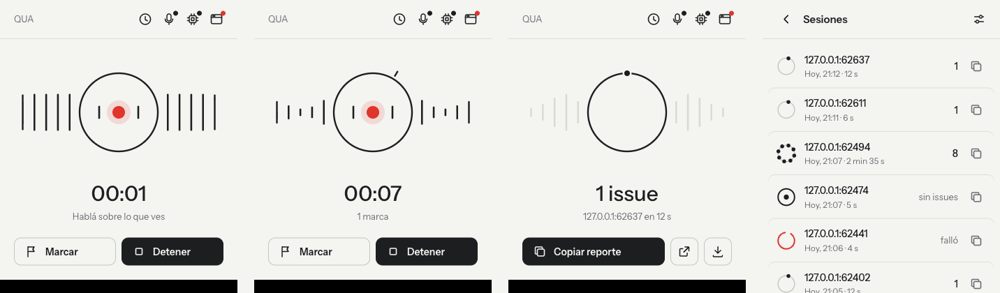
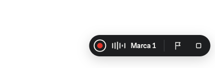
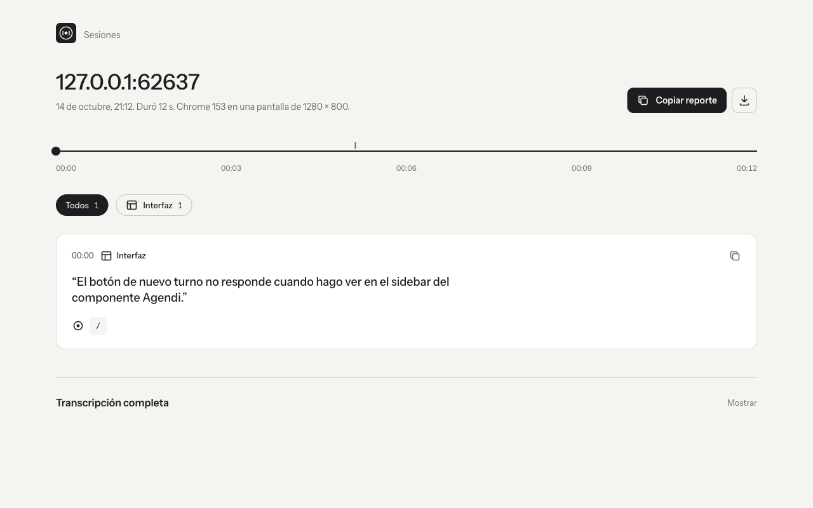
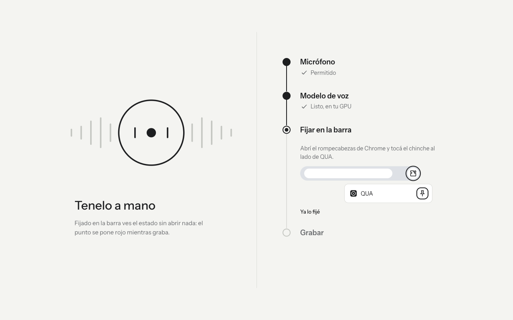

<p align="center">
  <picture>
    <source media="(prefers-color-scheme: dark)" srcset="assets/wordmark-dark.png">
    
  </picture>
</p>

<p align="center">
  <strong>Hablás sobre lo que ves. QUA lo convierte en un reporte de QA anclado a cada elemento.</strong>
</p>

<p align="center">
  
  
  
  
  <a href="./LICENSE"></a>
</p>

<p align="center">
  <a href="./README.md">English</a> · <b>Español</b>
</p>

---

Probás una web y vas diciendo en voz alta lo que ves: *"este botón no hace nada"*, *"acá el
texto se corta"*. QUA graba la sesión, transcribe tu voz y ancla cada comentario al elemento
que estabas mirando o clickeando, con selector, geometría, clases, ruta, errores de consola,
requests y una captura recortada. El resultado es un `report.md` listo para pegarle a tu agente
de código, a Linear o a Slack.

**Todo pasa dentro de Chrome.** No hay app, ni servidor, ni cuenta: Whisper corre en tu GPU con
WebGPU y el audio nunca sale del navegador.

<table>
<tr>
<td width="300" valign="top"></td>
<td valign="top">

```markdown
## 01 · bug · high
**Dicho** (00:01:26) — "Actualmente si presiono uno me lleva al
proyecto. Pero quizás lo mejor sería que cuando lo presione se
abra una pantalla propia por proyecto"

**Ancla** `#project-gallery > a:nth-of-type(2)`
  · confianza 0.74 · click −0.7s
**Elemento** el enlace que dice "PediloApp Sistema de pedidos…"
**Geometría** 314×310 px @ (697, 335) · viewport 1710×981 @2x
**Captura** 
```

<sub>Un issue real de una sesión real.</sub>

</td>
</tr>
</table>

## Por qué

Cuando revisás una interfaz, lo lento no es encontrar los problemas, es escribirlos. Ves diez
cosas en dos minutos y después pasás veinte explicando *qué* botón, *qué* pantalla y *qué*
decía la consola. Con agentes de código es peor: arreglan el bug en segundos, pero solo si les
decís exactamente dónde está.

Con QUA seguís hablando y clickeando. QUA se encarga de saber *dónde* lo dijiste.

## Cómo funciona

```
 micrófono ─▶ silero VAD ─▶ Whisper large-v3-turbo ─┐   offscreen doc, WebGPU
                                                    ├─▶ correlador ─▶ report.md + capturas
 DOM: clicks, hover, foco, consola, red, rutas ─────┘   Rust compilado a WASM
```

- **Voz**: silero VAD (onnxruntime-web) corta el audio en frases y Whisper large-v3-turbo
  (transformers.js sobre WebGPU, encoder fp16 + decoder q4) las transcribe. Sin GPU usa
  Whisper small en WASM.
- **Traza del navegador**: un content script registra clicks, hover, foco, cambios de ruta,
  errores de consola y requests, con selectores estables y la geometría de cada elemento. En
  builds de desarrollo de React también resuelve el archivo y el componente.
- **Correlador**: el corazón de QUA, escrito en Rust y compilado a WebAssembly. No es un join
  por timestamp: uno habla *después* de ver la cosa, así que puntúa los elementos con los que
  interactuaste hacia atrás en el tiempo, pesa hover, clicks y foco, y entiende deixis en
  español (*"este"*, *"acá"*, *"la sección de arriba"*). Ante la duda, ancla a la ruta en vez
  de inventar un elemento.
- **Reporte**: Markdown con una sección por issue (categoría, severidad, confianza, ancla,
  evidencia) y capturas recortadas. Las sesiones quedan en IndexedDB.

## Medido, no prometido

QUA empezó como un daemon nativo en Rust con whisper.cpp. Antes de reemplazarlo por una
extensión que corre solo en el navegador, medí las dos versiones sobre las mismas sesiones
reales:

| Qué | Resultado |
|---|---|
| Diferencia de transcripción contra whisper.cpp | **1,0 %** de las palabras |
| Issues del reporte | **los mismos 7**, con las mismas anclas |
| Procesar 153 s de audio | **77 s** con GPU |
| Del click en *Grabar* al primer audio | **~200 ms** |

La metodología y cada corrida están en [`docs/DECISIONS.md`](docs/DECISIONS.md) (sección L1).

## Cómo se ve

Una sola marca guía toda la UI: el anillo. Abriendo el micrófono gira, grabando late con tu
voz, procesando se llena y listo tiene un punto por cada issue.

<p></p>

- **Popup**: grabar, marcar un momento, detener, copiar o bajar el reporte. El historial
  (botón del reloj) lista las sesiones guardadas con sus issues.
- **En la página**: mientras grabás, una pastilla flotante muestra el tiempo, el nivel del
  micrófono y los botones de marcar y detener. Se arrastra a cualquier esquina y sus clicks
  no entran al reporte.

  
- **Ícono de la barra**: el mismo anillo, dibujado por estado (punto rojo grabando, se llena
  procesando, cantidad de issues en el badge cuando termina). Al terminar llega una
  notificación con **Copiar reporte**.
- **Visor del reporte**: línea de tiempo de la sesión, filtros por tipo, capturas y copiar
  issue por issue.

  
- **Primera vez**: cuatro pasos que se detectan solos (permiso del micrófono, modelo de voz,
  fijar en la barra, atajos).

  
- **Ajustes**: micrófono con prueba de nivel, modelo, atajos, espacio usado y borrar sesiones.

## Instalación

**Desde el código** (la publicación en Chrome Web Store está en camino):

```bash
pnpm install
pnpm --filter @qua/extension run build:wasm   # correlador de Rust → WebAssembly (necesita Rust + wasm-pack)
pnpm --filter @qua/extension run build        # → extension/build/chrome-mv3
```

Después, en `chrome://extensions` activá el **Modo de desarrollador**, tocá **Cargar
descomprimida** y elegí `extension/build/chrome-mv3`.

Requisitos: Node 26, pnpm 10, Rust con `wasm-pack` y un Chrome reciente. WebGPU es muy
recomendable.

## Uso

1. La primera vez se abre sola: permiso al micrófono, modelo de voz (~1 GB, se baja una sola
   vez de Hugging Face y queda en caché), fijarla en la barra y los atajos.
2. Abrí la página a revisar, tocá el anillo del popup (o `Ctrl+Shift+1` desde cualquier app) y
   hablá en voz alta sobre lo que ves. Con **Marcar** (`Ctrl+Shift+2`) dejás una marca en un
   momento.
3. **Detener** desde el popup o la pastilla. Al terminar llega una notificación y el popup
   muestra **Copiar reporte**, **Ver reporte** y **Descargar**
   (`Descargas/qua/<id>/report.md` con sus capturas).

## Privacidad

- El audio, las transcripciones, las trazas y los reportes quedan en tu máquina (IndexedDB y
  tu carpeta de Descargas).
- La única conexión que hace QUA es bajar los pesos de Whisper de Hugging Face la primera vez.
  Sin analytics, sin telemetría, sin cuenta.
- Solo graba mientras vos tocaste *Grabar*, y la pastilla está visible todo el tiempo.

Política completa: [`PRIVACY.md`](PRIVACY.md#política-de-privacidad).

## Cómo se construyó

QUA es un proyecto de una sola persona, hecho como ejercicio de **orquestar agentes de código**
sobre un sistema real y en varios lenguajes:

- **v1 (daemon)**: unas 26.000 líneas de Rust y TypeScript (daemon, CLI, servidor MCP, app de
  bandeja en Tauri, extensión de Chrome, whisper.cpp) en 101 commits durante una noche. Varios
  agentes trabajaron en paralelo (Opus en el correlador, Sonnet y Codex en el resto) contra
  **contratos congelados** (un protocolo en Zod espejado en Rust y validado con fixtures
  doradas de los dos lados) y un tablero compartido en [`STATE.md`](STATE.md). Salió con un
  test de punta a punta que maneja un Chrome real con un micrófono inyectado.
- **v2 (solo extensión)**: el daemon era un problema para instalar, así que pasé todo el
  pipeline al navegador: Whisper en WebGPU, silero en onnxruntime-web y el correlador de Rust
  compilado a WASM. Recién cambié después de medirlo (tabla de arriba).
- **v0.2 (UI)**: rediseño en Penpot y después implementación, arreglando cuatro bugs reales en
  el camino (momento de carga del content script, una migración de IndexedDB bloqueada,
  sesiones trabadas y una carrera del service worker). 219 tests más un E2E en Chrome real.

Cada decisión no obvia está escrita con su razón en [`docs/DECISIONS.md`](docs/DECISIONS.md); la
spec completa está en [`docs/SPEC.md`](docs/SPEC.md).

## Limitaciones

- **Primero en español.** Whisper transcribe muchos idiomas, pero la UI, las etiquetas del
  reporte y las reglas de deixis están en español. Inglés es lo próximo.
- **Solo Chrome** (Manifest V3, WebGPU, atajos globales).
- Sin WebGPU usa Whisper small en la CPU: tarda ~3 veces la duración del audio y transcribe un
  poco peor (2,6 % de diferencia).
- La primera vez baja ~1 GB de pesos del modelo.

## Estructura del repo

```
extension/               WXT + TypeScript (MV3) — el producto
crates/
  qua-core/              correlador y render del reporte (compartido entre extensión y daemon)
  qua-wasm/              qua-core compilado a WebAssembly
  qua-protocol/          espejo Rust del protocolo, testeado contra las fixtures
packages/
  protocol/              TS + Zod — fuente de verdad de todos los tipos
  source-resolver/       resolución de componente y archivo en React
  babel-plugin-source/,
  vite-plugin-source/    plugins opcionales que marcan cada elemento con su ubicación en el código
fixtures/                sesiones doradas — el contrato compartido TS ↔ Rust
e2e/                     sesiones reales en Chrome real
crates/quad, qua-mcp,
apps/qua-app, packaging/ daemon v1, servidor MCP y app Tauri (ver docs/DAEMON.md)
```

La arquitectura original (daemon en Rust + CLI + servidor MCP + app Tauri) sigue en el repo y
está documentada en [`docs/DAEMON.md`](docs/DAEMON.md).

## Desarrollo

```bash
pnpm install
pnpm test                                     # typecheck + vitest, incluye las fixtures doradas
pnpm --filter @qua/extension run build:wasm   # recompilar el WASM después de tocar crates/qua-core
node e2e/local.e2e.mjs                        # sesión completa en Chrome real
```

## Autor

Hecho por **Gabriel Funes**, ingeniero full-stack enfocado en IA, de Argentina.
[LinkedIn](https://www.linkedin.com/in/gabriel-funes-developer) · [GitHub](https://github.com/Gabriel100201)

## Licencia

[MIT](./LICENSE)
